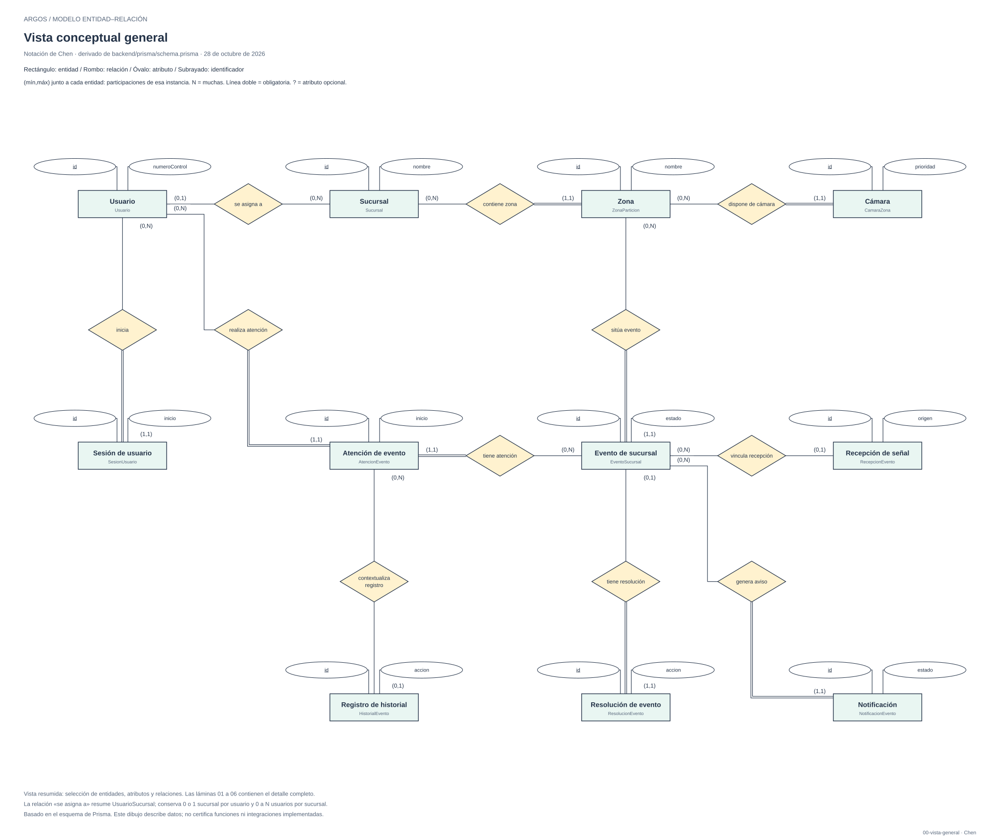

# Modelo entidad-relación de Argos: notación de Chen

Modelo conceptual **derivado del esquema de persistencia** de `backend/prisma/schema.prisma`, revisado el **28 de octubre de 2026**. Conserva sus entidades técnicas para mantener trazabilidad; no es un modelo de negocio independiente del diseño de almacenamiento. No modifica Prisma ni genera migraciones.

Se usan rectángulos para entidades, rombos para relaciones, óvalos para atributos e identificadores subrayados. Las claves foráneas se representan mediante relaciones; no se duplican como atributos. Los dominios enumerados, tipos SQL, índices y reglas de borrado se omiten del dibujo. Los enumerados y todos los atributos pueden consultarse en [trazabilidad.md](trazabilidad.md).

## Archivos

- **[argos-modelo-chen.drawio](argos-modelo-chen.drawio): documento editable con siete páginas**, en formato nativo mxGraph/Draw.io, preparado para importarlo en Lucidchart o abrirlo en diagrams.net. Cada entidad, relación, atributo y conexión es un objeto independiente.
- **[00-vista-general.svg](00-vista-general.svg): vista conceptual resumida**, para presentar el dominio sin mostrar toda la infraestructura de datos.
- **Seis SVG de detalle**: cobertura de las **26 entidades, 35 relaciones explícitas y 137 atributos no relacionales** del esquema actual.
- **[trazabilidad.md](trazabilidad.md)**: correspondencia con Prisma, cardinalidades y dominios de atributos.
- **[generar.py](generar.py)**: fuente reproducible de los SVG, el documento Draw.io y la trazabilidad; utiliza solamente la biblioteca estándar de Python.
- **[manifest.json](manifest.json)**: cantidades y huella SHA-256 del esquema utilizado.

| Lámina | Contenido | SVG |
| --- | --- | --- |
| 00 | Vista conceptual resumida: selección de entidades, atributos y relaciones | [Vista general](00-vista-general.svg) |
| 01 | Usuario, sesiones, dispositivos, permisos, plantillas y bloqueos | [Usuarios y acceso](01-usuarios-acceso.svg) |
| 02 | Sucursal, asignación de usuario, dirección, catálogos, horarios, descansos y contactos | [Sucursales y territorio](02-sucursales-territorio.svg) |
| 03 | Particiones, zonas, sensores y cámaras | [Infraestructura](03-infraestructura.svg) |
| 04 | Evento operativo y recepción técnica de señales | [Eventos y recepción](04-eventos-recepcion.svg) |
| 05 | Atención, historial y resolución | [Gestión de eventos](05-atencion-historial.svg) |
| 06 | Escalamiento, notificaciones e intentos de envío | [Notificaciones](06-notificaciones.svg) |

Las entidades azules se definen completas en esa lámina. Las verdes repiten entidades de otras láminas e incluyen únicamente su identificador para dar contexto. La vista general usa una selección de atributos para todas sus entidades. Los colores solo sirven de orientación y no añaden semántica a Chen.

## Importar en Lucidchart

La [documentación oficial de Lucidchart](https://help.lucid.co/hc/es/articles/16389149809428-Importa-archivos-a-Lucidchart) admite documentos Draw.io `.drawio` y `.xml`. Desde **Documentos → + Nuevo → Importar documentos**, selecciona `argos-modelo-chen.drawio`. Dentro de un documento también puedes usar **Más → Archivo → Importar → Importar documentos**.

Lucid indica que importar y visualizar está disponible en el plan gratuito; **editar documentos importados requiere un plan de pago**. El SVG sirve como imagen vectorial ampliable. Para conservar los objetos individuales, utiliza el documento Draw.io.

Este archivo usa la estructura XML nativa de Draw.io, no un XML genérico. Su estructura y los SVG se verificaron localmente. **No se realizó una importación real en una cuenta de Lucidchart.** Si Lucid rechaza el archivo generado, ábrelo en [diagrams.net](https://app.diagrams.net/), guárdalo desde el editor como `.drawio` y vuelve a importarlo; así se vuelve a serializar con la aplicación de origen que exige la documentación de Lucid. Las fuentes y la generación permanecen locales.

## Leer las cardinalidades

Se utiliza la extensión **mínimo–máximo** de Chen, junto con la participación total mediante línea doble:

- `(0,N)` junto a una entidad: cada una de sus instancias puede participar cero o muchas veces en esa relación.
- `(1,1)`: participa exactamente una vez. Su conexión con el rombo es doble.
- `(0,1)`: participa como máximo una vez y su participación es opcional.
- `?` en un óvalo señala que el atributo es opcional. Es una convención auxiliar de este documento.

**Las cardinalidades se leen junto a la entidad a la que pertenecen.** Por ejemplo, en «Usuario inicia Sesión», `(0,N)` junto a Usuario significa que una persona puede iniciar muchas sesiones; `(1,1)` junto a Sesión significa que cada sesión pertenece exactamente a una persona.

La colección inversa `[]` de Prisma no obliga a que exista un hijo. Por eso, una sucursal puede tener cero contactos o un evento cero recepciones según las restricciones expresadas en el esquema, aunque el flujo de negocio tenga condiciones más exigentes.

## Decisiones de modelado

- **UsuarioSucursal** se conserva como entidad de asociación porque tiene identificador y fechas propias. `usuarioId @unique` limita a una asignación actual por usuario. En la vista general se resume como el rombo «se asigna a» entre Usuario y Sucursal, omitiendo los atributos propios de la asignación.
- **PlantillaPermiso** permanece independiente. Compartir el enumerado `RolUsuario` con Usuario no crea una relación entre entidades. Tampoco se inventa una entidad Rol ni una relación entre plantilla y permiso.
- **Estado y Municipio** se relacionan de forma independiente con DirecciónSucursal. El esquema no declara una relación Municipio–Estado, así que no se añade al dibujo.
- **ZonaParticion** pertenece siempre a una sucursal y opcionalmente a una partición. No se exige una partición para cada zona.
- **RecepcionEvento** es la entrada técnica y puede no haber originado un evento. Varias recepciones pueden asociarse al mismo evento operativo.
- **AtencionEvento** y **HistorialEvento** tienen identidad y datos propios; se representan como entidades, aunque expresen participaciones de personas en la gestión de un evento. No se reducen a relaciones sin atributos.
- **ResolucionEvento** es opcional y única por evento. Su usuario responsable es obligatorio.
- Todas las entidades tienen `id` propio en Prisma; por eso se usan rectángulos simples, sin inventar entidades débiles ni relaciones identificadoras.

## Reglas que necesitan expresarse aparte

Las cardinalidades binarias no capturan todas las restricciones. Se conservan las siguientes observaciones sin convertirlas en relaciones nuevas:

1. Un evento y un usuario pueden tener muchas atenciones históricas, pero **como máximo una atención vigente cada uno**. El esquema usa dos restricciones compuestas con `vigente`; indica `true` para la vigente y `NULL` para la finalizada. No debe interpretarse como una relación histórica uno a uno.
2. Cuando una zona tiene partición, ambas deben pertenecer a la misma sucursal. La sucursal del evento debe coincidir con la de su zona. Estas coherencias entre varias relaciones necesitan validación adicional.
3. La sesión de una atención debe corresponder a su usuario. En el historial, el usuario opcional identifica al actor humano; su ausencia representa una acción automática.
4. Una notificación no repite la combinación evento–dispositivo–destinatario. Sus intentos tienen un número único dentro de esa notificación. El destinatario debe corresponder al usuario de la sesión del dispositivo y la escalada opcional al mismo evento; las claves foráneas independientes no bastan para garantizarlo.
5. El actor que finaliza un bloqueo puede ser nulo por vencimiento automático. Las condiciones de desbloqueo manual, las transiciones de estado, los permisos y las operaciones atómicas pertenecen a reglas de negocio y no se deducen únicamente de la cardinalidad.

El modelo describe la estructura declarada en Prisma. No acredita una base de datos desplegada ni el funcionamiento de hardware, recepción DC-09, video o canales de notificación.

## Regenerar

Desde la raíz del repositorio, con Python 3.10 o posterior:

```bash
python3 docs/mer/generar.py
```

El generador comprueba que cada entidad se defina en exactamente una lámina de detalle y que cada relación explícita se represente una vez entre esas seis láminas. Si se agregan modelos o relaciones a Prisma, detiene la generación hasta que se actualice la distribución. Para incorporar nuevas entidades, deben actualizarse sus nombres y su ubicación; los atributos no relacionales existentes se leen del esquema.

**Edición:** puedes modificar el `.drawio` en el editor de diagramas; una regeneración lo reemplaza. Para conservar ajustes reproducibles de distribución o etiquetas, trasládalos a `generar.py` antes de regenerar. Las ediciones manuales del `.drawio` no actualizan automáticamente los SVG.


