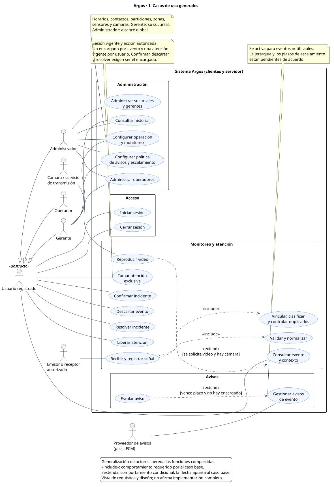
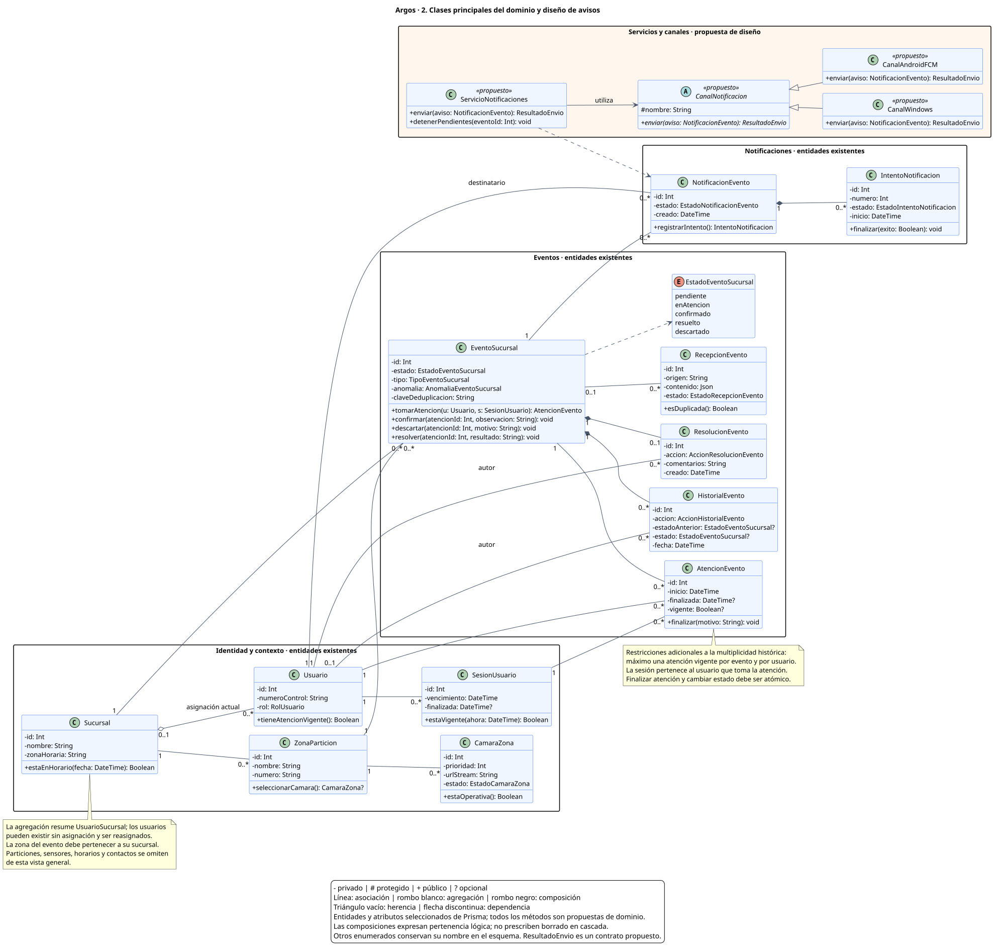
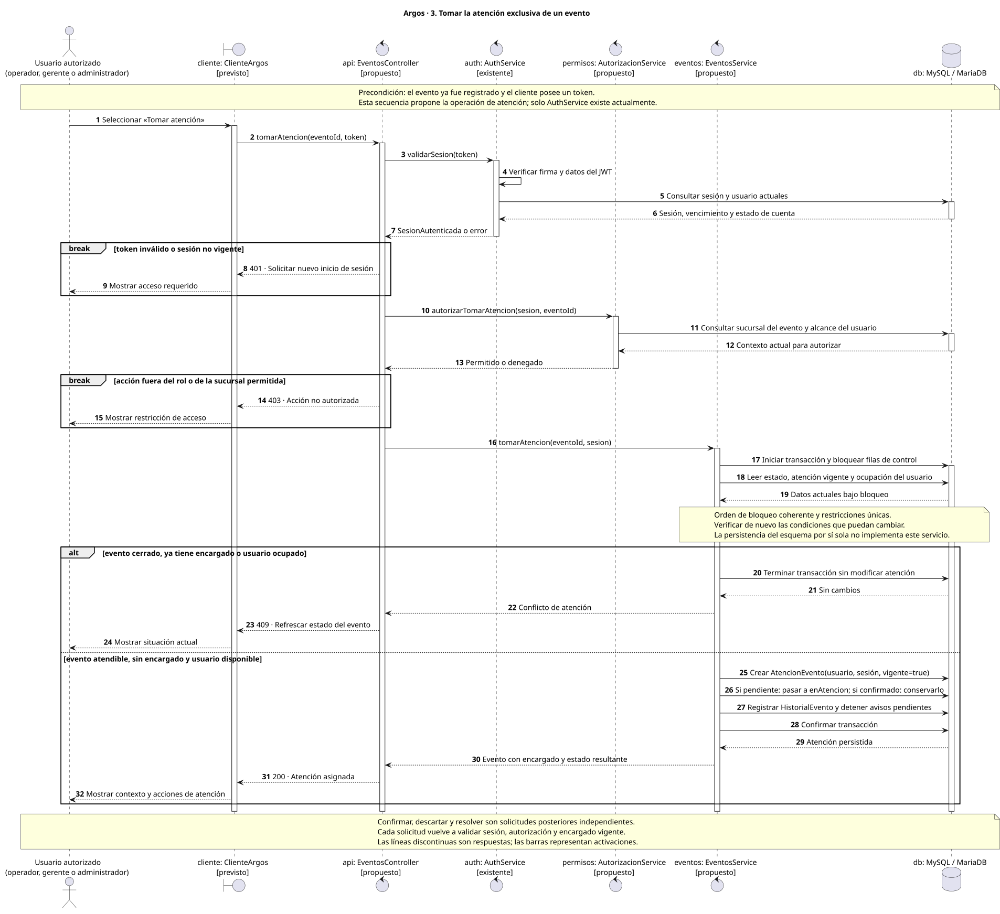
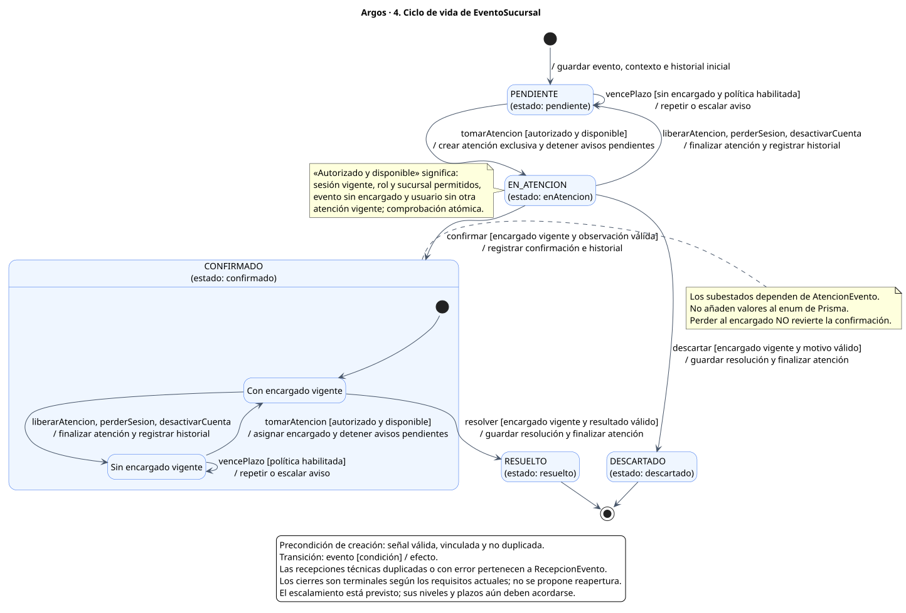
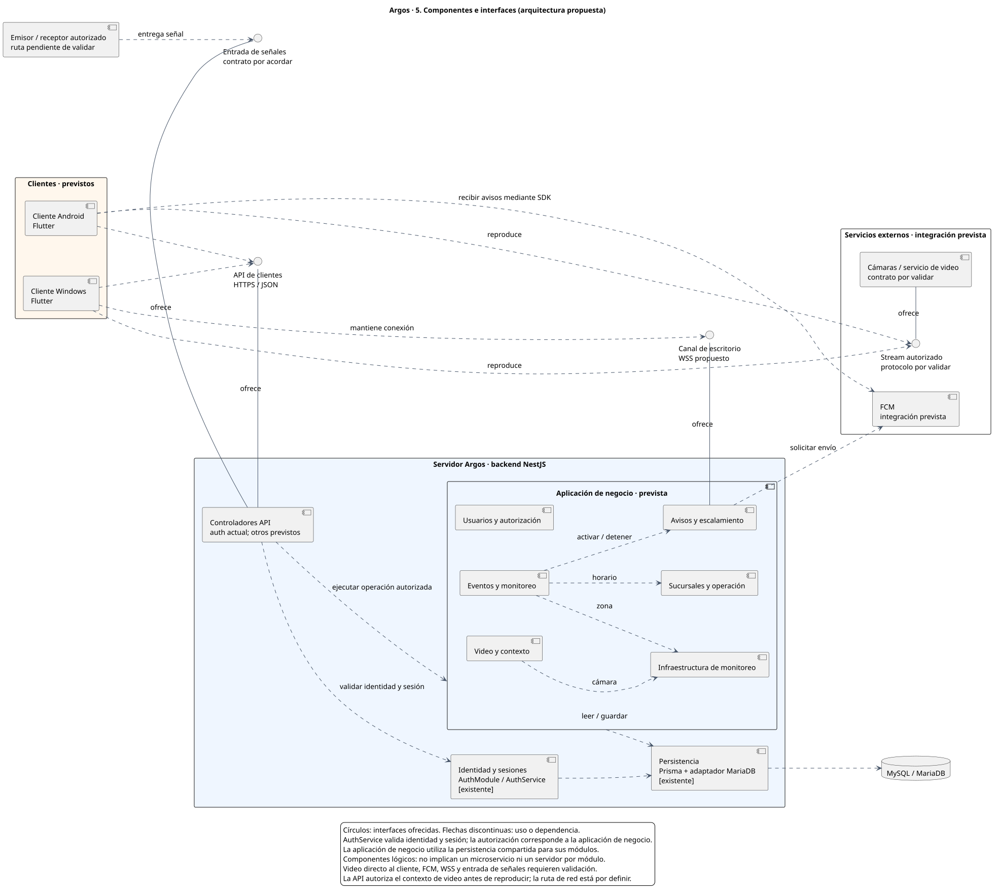
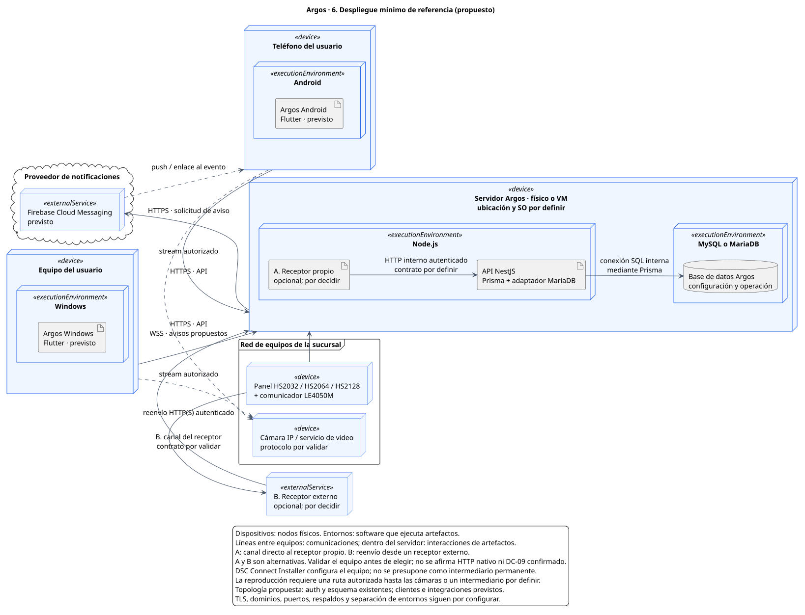

# Diagramas UML de Argos: propuesta general

Primera versión para discutir el diseño y preparar la entrega académica. Se basa en los requisitos y el código disponibles en el repositorio al **24 de octubre de 2026**. Describe el sistema previsto y señala las decisiones pendientes; no certifica que todas las funciones estén implementadas.

## Los seis diagramas

Cada diagrama tiene una imagen SVG ampliable y un archivo PlantUML editable. Las imágenes pueden abrirse en un navegador e insertarse en documentos.

| Diagrama | Imagen | Fuente editable | Pregunta que responde |
| --- | --- | --- | --- |
| 1. Casos de uso | [Ver SVG](01-casos-de-uso.svg) | [PlantUML](01-casos-de-uso.puml) | ¿Quién utiliza Argos y para qué? |
| 2. Clases | [Ver SVG](02-clases.svg) | [PlantUML](02-clases.puml) | ¿Qué entidades, comportamientos y relaciones necesita? |
| 3. Secuencia | [Ver SVG](03-secuencia.svg) | [PlantUML](03-secuencia.puml) | ¿Cómo se coordina la toma de atención de un evento? |
| 4. Estados | [Ver SVG](04-estados.svg) | [PlantUML](04-estados.puml) | ¿Cómo cambia un evento durante su gestión? |
| 5. Componentes | [Ver SVG](05-componentes.svg) | [PlantUML](05-componentes.puml) | ¿Cómo se divide el software y cómo se comunica? |
| 6. Despliegue | [Ver SVG](06-despliegue.svg) | [PlantUML](06-despliegue.puml) | ¿Dónde se ejecutaría cada parte y cómo se conectaría? |

## Alcance y situación actual

| Elemento | Evidencia en el repositorio | Tratamiento en los diagramas |
| --- | --- | --- |
| Backend NestJS, Prisma y adaptador MariaDB | `backend/src/app.module.ts`, `backend/libs/db.ts` | Base tecnológica existente. |
| Inicio, validación y cierre de sesión | `backend/src/auth/` | Componente existente de autenticación. |
| Entidades, atributos, enumerados y relaciones | `backend/prisma/schema.prisma` | Base del modelo de clases; selección de los elementos principales. No se comprobó la base de datos real. |
| Autorización y demás módulos funcionales | Requisitos; no están registrados como módulos implementados en `AppModule` | Diseño previsto. Autorización se mantiene separada de autenticación. |
| Clientes Android y Windows | `frontend/README.md`; todavía sin proyecto Flutter | Clientes previstos. |
| Receptor DC-09 propio | `dc09-receiver/README.md`; decisión pendiente | Alternativa de integración. No se afirma compatibilidad validada con el equipo. |
| FCM, canal Windows, video y despliegue | READMEs y requisitos | Integraciones y topología propuestas, pendientes de validación. |

## 1. Casos de uso

El límite comprende **los clientes y el servidor de Argos**. Las personas, el emisor de señales, el proveedor de avisos y las cámaras son actores externos. Los dispositivos cliente pertenecen al sistema, por lo que aquí no se representan como actores independientes.

Administrador, gerente y operador especializan al actor general «Usuario registrado» y comparten acceso y atención de eventos. Esto expresa funciones compartidas; no convierte sus roles en subclases de la tabla `Usuario` ni hace que el administrador herede indiscriminadamente las restricciones del gerente.

El administrador tiene alcance global; el gerente administra operadores y configuración de su sucursal. Las decisiones de un evento requieren ser su encargado vigente, con sesión y autorización válidas. La consulta general de historial corresponde a administrador o gerente.

Las relaciones `include` señalan tareas requeridas para procesar una señal. Las relaciones `extend` representan video solicitado cuando hay cámara y escalamiento cuando vence un plazo sin encargado. Las flechas de extensión apuntan al caso base. No se dibuja el inicio de sesión como un `include` de cada operación: las acciones protegidas tienen una sesión vigente como precondición.

La configuración operativa agrupa horarios, contactos, particiones, zonas, sensores y cámaras. Es una vista general, no el inventario exhaustivo de cada alta, consulta, cambio y baja. Los avisos se activan por el flujo de eventos notificables; las tareas automáticas no se atribuyen a un actor humano ficticio.



## 2. Clases

Es una **vista conceptual de dominio y diseño**, con entidades basadas en Prisma y operaciones propuestas. Prisma define datos y relaciones; no contiene los métodos dibujados. La visibilidad privada de los atributos y las operaciones públicas representan encapsulación conceptual, no declaraciones ya presentes en el cliente generado.

Se incluyen atributos seleccionados, tipos, visibilidad y multiplicidades. Los tipos de enumerados omitidos del dibujo conservan sus nombres del esquema. `ResultadoEnvio` es un contrato propuesto para expresar el resultado de un canal.

Las relaciones principales se interpretan así:

- **Asociación:** usuarios, sesiones, eventos, zonas, cámaras y atenciones se relacionan sin asumir que todos comparten ciclo de vida.
- **Agregación:** una sucursal agrupa usuarios que pueden existir sin asignación y ser trasladados. Resume la relación intermedia `UsuarioSucursal`; cada usuario tiene como máximo una asignación actual.
- **Composición:** el historial y la resolución pertenecen a un evento; cada intento pertenece a una notificación. Es pertenencia lógica y no una instrucción de borrado en cascada.
- **Herencia:** `CanalAndroidFCM` y `CanalWindows` especializan el canal abstracto propuesto. Esta jerarquía demuestra una abstracción útil sin inventar subclases de usuarios por rol.
- **Multiplicidad:** un evento tiene muchas atenciones históricas, pero como máximo una vigente. Cada usuario también puede tener como máximo una atención vigente. Estas restricciones temporales complementan el `0..*` del historial.

Se omiten de esta vista general particiones, sensores, horarios, contactos, bloqueos, permisos, dispositivos de sesión y escalamientos. Permanecen en el esquema y en el alcance funcional. La selección no cambia sus relaciones.

Los métodos que modifican eventos representan reglas que los servicios del backend tendrían que ejecutar dentro de transacciones. El diagrama no exige implementar entidades con acceso directo a la base de datos.



## 3. Secuencia

El escenario elegido es **tomar la atención exclusiva de un evento ya registrado**. Muestra actor, cliente, controlador, autenticación, autorización, servicio de eventos y base de datos, con mensajes numerados, respuestas, líneas de vida y activaciones.

Primero se valida la sesión y después se autoriza la acción. Si alguna comprobación falla, el fragmento `break` termina el recorrido. El servicio propuesto comprueba bajo transacción que el evento siga disponible y que el usuario no atienda otro evento. El fragmento `alt` distingue conflicto y asignación exitosa.

La atención, el estado y su historial se guardan de manera atómica. Un evento pendiente pasa a `enAtencion`; uno confirmado sin encargado conserva `confirmado` al ser tomado. Las respuestas `200`, `401`, `403` y `409` describen el contrato propuesto para esta operación; no afirman que exista ya un endpoint de eventos.

Este diagrama detalla un caso representativo. La recepción, la entrega de avisos y el cierre del incidente pueden documentarse después en secuencias independientes.



## 4. Estados

La entidad elegida es `EventoSucursal`, con los cinco valores actuales del esquema: `pendiente`, `enAtencion`, `confirmado`, `resuelto` y `descartado`.

Una señal válida, vinculada y no duplicada crea el evento pendiente. Al tomarlo pasa a atención. Desde atención puede confirmarse, descartarse con motivo o volver a pendiente si se libera. Un incidente confirmado termina resuelto cuando el encargado registra el resultado de la gestión.

**Un confirmado que pierde al encargado permanece confirmado.** El dibujo utiliza dos subestados para expresar si tiene encargado vigente. Se derivan de `AtencionEvento` y no añaden valores al enumerado. El comportamiento de conservación del estado también aparece en el cierre de sesión del `AuthService` actual.

Las etiquetas siguen `evento [condición] / efecto`. Las recepciones duplicadas o con error son estados técnicos de `RecepcionEvento`, no nuevos estados del incidente. El video y las notificaciones tampoco cambian por sí solos el estado operativo. No se propone reapertura de eventos cerrados.



## 5. Componentes

Se separan los clientes Android/Windows, las interfaces del backend, la autenticación existente y los módulos previstos: usuarios/autorización, sucursales, infraestructura, eventos, avisos y video. Los módulos son divisiones lógicas dentro del backend; no requieren un servidor ni un microservicio por módulo.

Las interfaces señalan API de clientes, entrada de señales, canal de escritorio y transmisión de video. Prisma concentra la persistencia. Los servicios externos son el emisor o receptor, FCM y las cámaras o servicio de transmisión.

La API autoriza el contexto de video. La reproducción directa desde el cliente es una alternativa pendiente de conectividad y compatibilidad. Si se necesita un intermediario de video, el diseño debe actualizarse después de esa validación.



## 6. Despliegue

Se propone una instalación inicial pequeña: clientes en Android y Windows, API en Node.js y MySQL o MariaDB en el servidor Argos. Compartir host para API y base de datos es una posibilidad inicial, no una decisión de producción ni una prueba de capacidad o disponibilidad.

Se muestran las dos alternativas de recepción: receptor propio o receptor externo que reenvía al backend. **Son alternativas que se deben evaluar; no se requiere desplegar ambas.** El hardware, el protocolo y los contratos de integración siguen pendientes de validación.

FCM sería un servicio externo para Android. WSS es una propuesta para el canal activo de Windows. Los protocolos y la ruta de acceso a las cámaras también deben confirmarse. DSC Connect Installer se considera herramienta de configuración; no se presupone que opere como intermediario permanente.

SO del servidor, proveedor, dominios, TLS, puertos públicos, respaldos y separación física de servicios quedan por definir. Desarrollo, pruebas y producción deben usar configuraciones y credenciales separadas. Este diagrama no afirma que exista un despliegue de producción verificado.



## Trazabilidad con los requisitos

Los números de RF se interpretan dentro de cada módulo del documento original; no se renumeraron ni corrigieron sus saltos.

| Diagrama | Referencias principales |
| --- | --- |
| Casos de uso | RF de los seis módulos: acceso, administración, configuración, eventos, avisos y contexto. |
| Clases | Esquema Prisma; RF de módulos 1, 2, 3, 4 y 5. |
| Secuencia | Módulo 4, RF 07 (tomar atención); módulo 1, RF 14 (permisos); RNF Seguridad 01, 03 y 04. |
| Estados | Tabla del ciclo de vida; módulo 4, RF 07–11; cierre de sesión de `AuthService`. |
| Componentes | Tabla de módulos; RNF Mantenimiento 02 y 09; READMEs de backend, frontend y receptor. |
| Despliegue | RNF Operación 01–07; RNF Seguridad 06; flujo propuesto del README principal. |

## Decisiones pendientes antes de una versión final

- Confirmar la ruta real de recepción, contrato, identificación de origen, confirmaciones y comportamiento de los reenvíos.
- Acordar la política configurable de escalamiento, sus destinatarios y plazos; no fijar la jerarquía en código por este boceto.
- Validar FCM, canal Windows, funcionamiento del cliente en segundo plano y enlaces a eventos.
- Validar protocolo de video, reproductores, acceso de red y posible intermediario.
- Elegir el entorno de despliegue y su configuración operativa.

## Edición y generación de imágenes

Los archivos `.puml` son la fuente. Se pueden editar como texto y renderizar con PlantUML. Los SVG de esta versión se generaron localmente con **PlantUML 1.2026.9**, Java en modo sin interfaz gráfica y el motor Smetana; no se enviaron los diagramas a un renderizador remoto.

Con Java y un archivo `plantuml.jar` disponible, desde la raíz del repositorio:

```bash
java -Djava.awt.headless=true -jar /ruta/plantuml.jar -charset UTF-8 -tsvg docs/uml/*.puml
```

Para generar PNG, sustituye `-tsvg` por `-tpng`. Los diagramas que requieren distribución de nodos declaran `!pragma layout smetana`, lo que permite renderizarlos sin instalar Graphviz. El diagrama de secuencia utiliza su motor específico.

Se verificó la generación de los seis SVG y se revisaron sus vistas renderizadas. Esta validación corresponde a los documentos, no a la ejecución de las funciones, integraciones ni infraestructura propuestas.

## Fuentes

- [Requisitos funcionales y no funcionales de Argos](../RF%20%26%20RNF.md).
- [Esquema Prisma](../../backend/prisma/schema.prisma).
- [README principal](../../README.md), [frontend](../../frontend/README.md), [backend](../../backend/README.md) y [receptor](../../dc09-receiver/README.md).
- [Responsabilidades del módulo de autenticación](../../backend/src/auth/README.md).
- Documentación oficial de PlantUML: [casos de uso](https://plantuml.com/use-case-diagram) y [motor Smetana](https://plantuml.com/smetana02).
